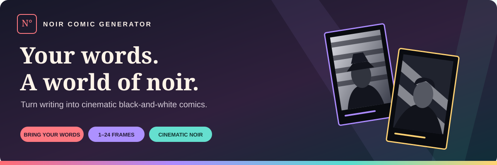
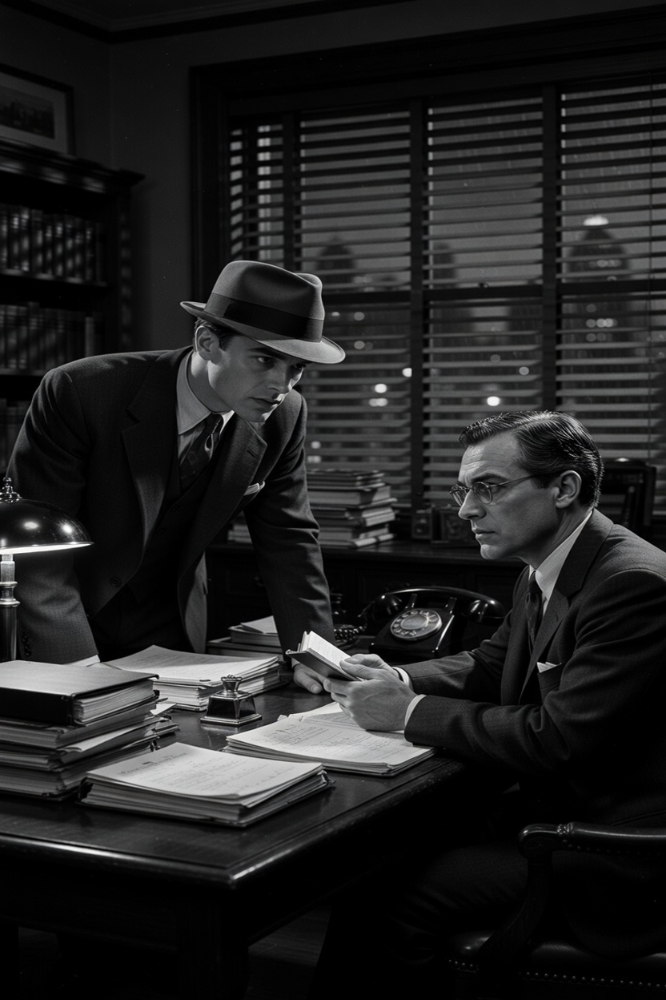

  <strong>Bring your writing to life in cinematic black and white.</strong> 
  Stories, essays, and ideas become scenes, characters, and readable dialogue.

## Your story deserves a scene

A late-night conversation. A missing clue. An argument that changes how someone sees the world.

Noir Comic Generator turns your writing into a sequence of atmospheric comic panels: dramatic lighting, expressive faces, deep shadows, and the unmistakable mood of classic film noir.

You bring the words. Choose how many frames you want. Let your story take shape.

## Big atmosphere. Your original meaning.

**Cinematic imagery**  
Black-and-white, photographic-style scenes with rich contrast and a classic noir atmosphere.

**Words you can actually read**  
Clean speech balloons sit outside the photographs, keeping dialogue clear and faces visible.

**A frame count that fits your story**  
Choose anywhere from 1 to 24 panels, whether you want a single moment or a longer sequence.

**More than fiction**  
Bring a short story, an essay, a philosophical argument, or a conversation. The experience is designed to keep your original meaning at the center.

  
   
  <em>A real image generated with Noir Comic Generator.</em>

## Choose the experience

**ChatGPT — SFW**  
The default choice for safe-for-work stories, ideas, and everyday scenes.

**Venice — Mature**  
A choice for non-explicit mature themes, including strong language, darker stories, and non-graphic adult romance.

**Automatic**  
Prefer not to choose? Let the app select between the two based on your writing.

Mature does not mean explicit. Explicit sexual content and graphic gore are not supported, and some non-explicit scenes may still be declined.

## From writing to comic in three steps

**1. Bring your words.**  
Paste your writing or import a text file.

**2. Choose your frames.**  
Pick your panel count and preferred image option.

**3. Generate your comic.**  
See your writing become a sequence of noir scenes with readable dialogue.

## Made for people with something to say

For writers exploring a scene. For educators presenting an idea. For thinkers turning an argument into a conversation. For anyone curious to see their words in a different form.

**Bring a story. Pick your frames. Give it the noir treatment.**

---

Created by **Dr. Kuczynski, AI-Architect**.
